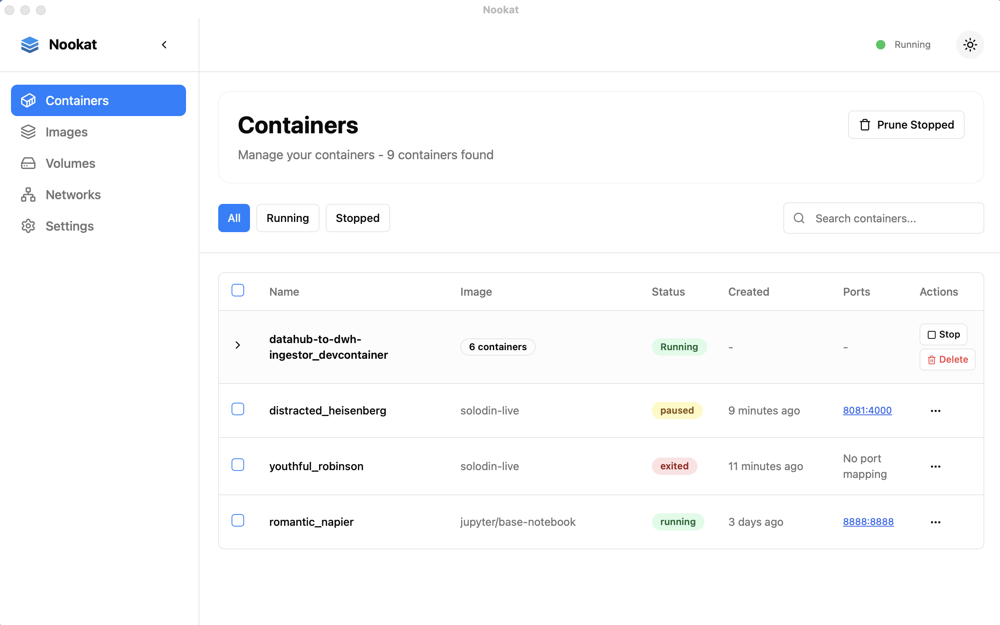

<h1 align="center">
  
</h1>

<p align="center">
Nookat is a lightweight container management tool that provides all the essential features you need without the bloat.
Fast, intuitive, and completely free.
</p>

<p align="center">
Built with <strong>Tauri</strong>, <strong>React</strong>, and <strong>TypeScript</strong>.
</p>

<div align="center">


[](https://www.rust-lang.org/)
[](https://react.dev/)
[](https://tauri.app/)

</div>

<div align="center">

[](https://github.com/nookat-io/nookat/releases)
[](https://github.com/nookat-io/nookat/releases)
[](https://github.com/nookat-io/nookat/releases)

</div>

<div align="center">

**Get started** [Download](https://github.com/nookat-io/nookat/releases) | [Website](https://nookat.io/)

</div>

---

## Key Features

- **🚀 Lightweight & Fast**: Built with Rust and Tauri
- **📦 Containers**: Start, stop, restart, pause, remove and prune containers, and more
- **🧩 Compose Projects**: Manage grouped containers easily
- **🖼️ Images**: Pull images with live progress, remove images and tags, and prune unused ones
- **🌐 Networks**: Create and remove networks
- **💾 Volumes**: Browse volumes with their sizes, and remove or prune them
- **🔧 Managed Colima Engine (macOS only)**: Install [Colima](https://github.com/abiosoft/colima) from the app settings, and start or stop its VM from Nookat
- **🎨 Themes**: Light, dark or system theme from the toggle in the header
- **⚙️ Settings**: Start on system boot, close to tray, and update checks
- **🆓 Completely Free**: No premium features, no subscriptions

## Screenshots

<div align="center">


_Container management interface_

</div>

> **📸 More Screenshots Available**
>
> Explore the complete collection of screenshots in the [`screenshots/`](screenshots/) folder, including both light and dark theme variants for all major features

## Installation

### System Requirements

- **macOS**: macOS 11 (Big Sur) or later on Apple Silicon or Intel
- **Linux**: an `x86_64` or `aarch64` distribution, like Ubuntu 22.04, Debian 12 or Fedora 37 and newer
- **Windows**: Windows 10 or later on `x86_64`

### Download Nookat

Download the file for your platform from the latest [GitHub Release](https://github.com/nookat-io/nookat/releases):

| Platform | Architecture            | File                                                                                                  |
| -------- | ----------------------- | ----------------------------------------------------------------------------------------------------- |
| macOS    | Apple Silicon and Intel | `Nookat_<version>_universal.dmg`                                                                      |
| Windows  | `x86_64`                | `Nookat_<version>_x64-setup.exe` or `Nookat_<version>_x64_en-US.msi`                                  |
| Linux    | `x86_64`                | `Nookat_<version>_amd64.deb`, `Nookat-<version>-1.x86_64.rpm` or `Nookat_<version>_amd64.AppImage`    |
| Linux    | `aarch64`               | `Nookat_<version>_arm64.deb`, `Nookat-<version>-1.aarch64.rpm` or `Nookat_<version>_aarch64.AppImage` |

On Linux, pick `.deb` for Debian and Ubuntu, `.rpm` for Fedora and openSUSE, and `.AppImage` for any other distribution.

### Updates

Nookat gets new versions through the signed Tauri updater.
With **Check for updates** on in **Settings > General**, Nookat checks at most once a day and announces a new version.
**Check Now** checks once on demand.
**Install Update** in **Settings > General** downloads and installs the new version, then restarts Nookat.

### macOS: first launch

The macOS builds are not signed with an Apple Developer ID, so Gatekeeper will refuse to open the app on the first launch with a message like "Nookat cannot be opened because Apple cannot check it for malicious software".
The warning means macOS cannot tell who published the app, which is expected here: releases are built by the public [release workflow](.github/workflows/build-macos.yaml) in this repository, and we do not currently hold the Apple Developer Program membership that signing and notarization require.

To allow it, open the DMG, drag Nookat to Applications, and then either:

- Right-click (or Control-click) Nookat in Applications and choose **Open**, then confirm **Open** in the dialog, or
- Open Nookat normally and let macOS block it, then go to **System Settings -> Privacy & Security**, scroll to the message about Nookat being blocked, and click **Open Anyway**.
  The message and the button only appear after a blocked launch attempt.

You only need to do this once.
Prefer either of these over stripping the quarantine attribute by hand: they scope the exception to this one app and leave macOS to keep checking everything else you download.

## Development Setup

### Prerequisites

- [Node.js](https://nodejs.org/en) 22.22.2 or later 22.x, 24.15 or later 24.x, or 26 and newer; CI uses the current LTS
- [Rust](https://rustup.rs/) (latest stable)
- [just](https://github.com/casey/just) and [pre-commit](https://pre-commit.com/)
- The [Tauri system prerequisites](https://tauri.app/start/prerequisites/) for your platform, for example `libwebkit2gtk-4.1-dev build-essential curl wget file libxdo-dev libssl-dev libayatana-appindicator3-dev librsvg2-dev` on Debian and Ubuntu
- On Windows, [Git for Windows](https://gitforwindows.org/), because the `just` recipes need a POSIX shell, so run them from Git Bash
- A running Docker API compatible engine and the `docker` CLI on your `PATH`, to see the app work

### Build from Source

```bash
git clone https://github.com/nookat-io/nookat.git
cd nookat
just install
just tauri_dev
```

`just install` installs the npm dependencies, the pre-commit hooks and the `rustfmt` and `clippy` components, and creates `.env` from `env.example`.
`just tauri_dev` starts the app in development mode.
`just tauri_build` builds the release bundles, and it needs the updater signing key in `TAURI_SIGNING_PRIVATE_KEY`, which only the release workflows have.
Run `just --list` to see every recipe.

### Checks

CI runs these, so run them before you open a pull request:

- `npm run lint` - ESLint with no warnings allowed
- `npm run type-check` - TypeScript
- `npm test` - Vitest unit tests
- `npm run format` - Prettier, which rewrites files in place
- `just pre_commit` - every pre-commit hook on every file, including `cargo fmt`, `cargo clippy` and `cargo test`
- `cargo test` from `src-tauri/` - the Rust tests on their own

## Architecture

- **Frontend**: React with TypeScript and Tailwind CSS in `src/`
- **Backend**: Rust with Tauri in `src-tauri/`, split into three layers:
  - `entities/` - serde types shared with the frontend, with no I/O
  - `services/` - all logic and side effects, talking to the daemon through [bollard](https://github.com/fussybeaver/bollard)
  - `handlers/` - thin `#[tauri::command]` wrappers that delegate to the services
- **State push model**: `services/engine_state_monitor.rs` follows the Docker events stream, polls every 5 seconds, and emits the whole engine state to the frontend as the `engine_state_update` event.
  The frontend does not poll for lists: `src/lib/engine-provider.tsx` listens for that event and is the single source of truth.
- **Engine detection**: Nookat needs the `docker` CLI on `PATH`, and reports the engine as unknown without it.
  With the CLI present, it tries `DOCKER_HOST` first, then the endpoints of the Docker contexts, then the platform default socket.
  On macOS, when none of them answers, **Settings > Engine** can install and start a managed Colima.

## Contributing

We welcome contributions from the community!
Here's how to get started:

1. Look at [`tasks/README.md`](tasks/README.md) and [`tasks/ROADMAP.md`](tasks/ROADMAP.md) for planned work, or open an issue first for anything larger
2. Fork the repository and create a branch
3. Run `just install` so the pre-commit hooks check every commit
4. Use [conventional commit](https://www.conventionalcommits.org/en/v1.0.0/) messages, such as `feat: add volume export` or `fix: keep the selection after a refresh`
5. Make sure the [checks](#checks) pass, then open a pull request

## Recommended IDE Setup

- [VS Code](https://code.visualstudio.com/) with extensions:
  - [Tauri](https://marketplace.visualstudio.com/items?itemName=tauri-apps.tauri-vscode)
  - [rust-analyzer](https://marketplace.visualstudio.com/items?itemName=rust-lang.rust-analyzer)

## License

Nookat is licensed under the [Apache License 2.0](LICENSE).

## Acknowledgements

- Built with [Tauri](https://tauri.app/), [React](https://react.dev/), [Rust](https://www.rust-lang.org/) and [bollard](https://github.com/fussybeaver/bollard)

## Community

- **GitHub**: [nookat-io/nookat](https://github.com/nookat-io/nookat)
- **Issues**: [Report bugs or request features](https://github.com/nookat-io/nookat/issues), after searching the existing ones
- **Discussions**: [Ask questions and join the community](https://github.com/nookat-io/nookat/discussions)

---

<div align="center">

**Made with ❤️ for the container community**

</div>
